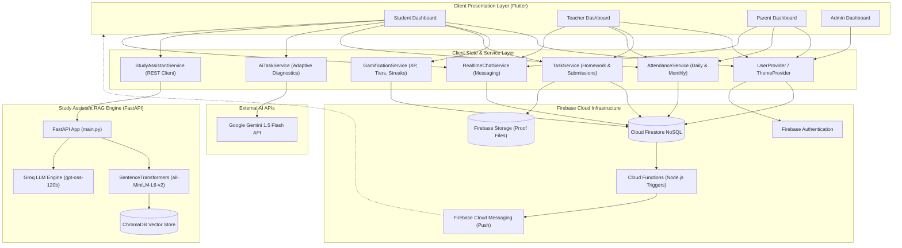
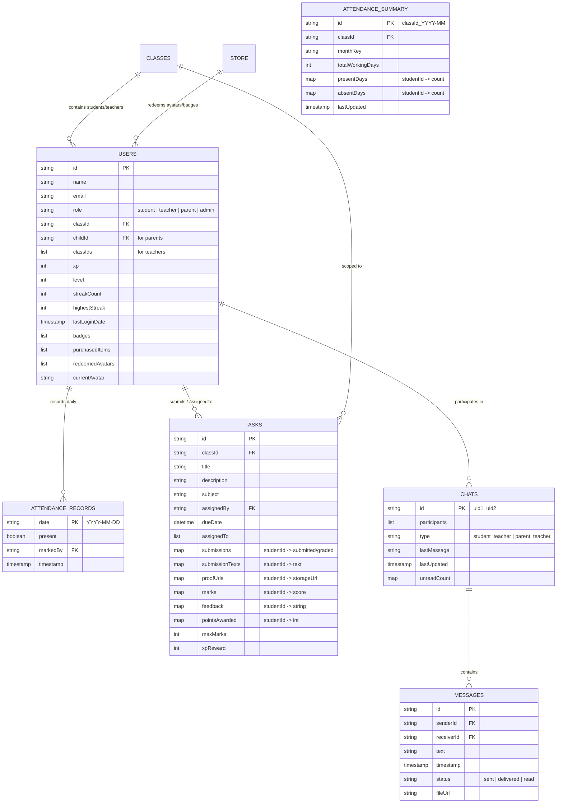
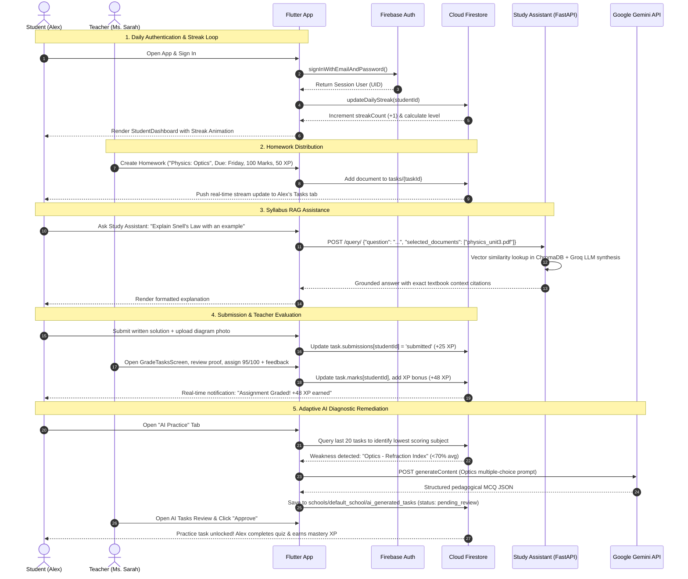
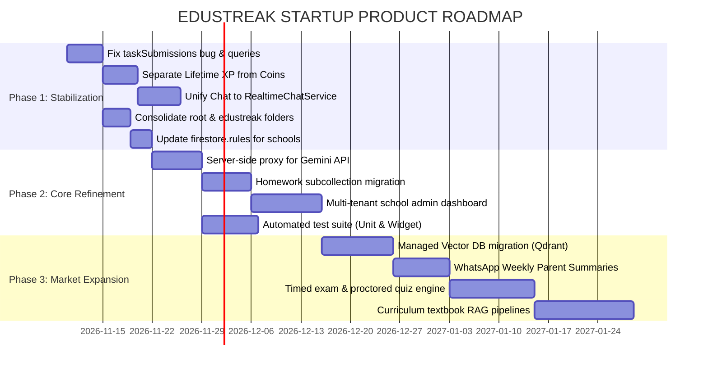

# EDUSTREAK — Complete Project Understanding, Technical Audit & Startup-Level Product Analysis

**Project Name:** EDUSTREAK  
**Domain:** Education Technology (EdTech)  
**Target Audience:** School Students, Teachers, Parents, and Administrators  
**Document Type:** Senior Technical Architecture & Startup Product Evaluation Report  
**Date of Audit:** November 2026  
**Auditor:** Senior Software Architect, Full-Stack Developer, EdTech PM & Startup Consultant  

---

## Table of Contents
1. [Executive Project Summary](#1-executive-project-summary)
2. [Problem Statement and Proposed Solution](#2-problem-statement-and-proposed-solution)
3. [Target Audience & User Personas](#3-target-audience--user-personas)
4. [Existing Feature Inventory](#4-existing-feature-inventory)
5. [Complete Technology Stack](#5-complete-technology-stack)
6. [Technology Stack Justification](#6-technology-stack-justification)
7. [System Architecture Diagram](#7-system-architecture-diagram)
8. [Database Architecture & Entity Relationships](#8-database-architecture--entity-relationships)
9. [User Roles and Permissions Matrix](#9-user-roles-and-permissions-matrix)
10. [Complete Application Workflow](#10-complete-application-workflow)
11. [Existing UI/UX Evaluation](#11-existing-uiux-evaluation)
12. [Strengths and Weaknesses](#12-strengths-and-weaknesses)
13. [Missing Features & Gap Analysis](#13-missing-features--gap-analysis)
14. [Startup-Level Feature Opportunities & Differentiation](#14-startup-level-feature-opportunities--differentiation)
15. [Scalability and Security Recommendations](#15-scalability-and-security-recommendations)
16. [Recommended Product Roadmap](#16-recommended-product-roadmap)
17. [Final Technical Assessment & Sign-Off](#17-final-technical-assessment--sign-off)

---

## 1. Executive Project Summary

**EDUSTREAK** is an active, cross-platform, gamified EdTech ecosystem engineered for primary and secondary education. The platform moves beyond static Learning Management Systems (LMS) by centering its value proposition on **habit-forming behavioral psychology**: daily login streaks, cumulative experience points (XP), profile tier borders, achievement badges, and real-time classroom leaderboards.

The technical implementation is split across two core operational pillars:
1. **The Cross-Platform Client Application (Flutter):** Provides role-based portals for Students, Teachers, Parents, and Administrators. It communicates in real-time with Google Cloud Firestore, Firebase Auth, and Firebase Storage.
2. **The Dual AI Engines:**
   - **Personalized Weak-Topic Generator:** A Flutter service (`AiTaskService`) evaluating student performance on recent assignments to generate adaptive diagnostic multiple-choice questions via Google Gemini 1.5 Flash or OpenAI.
   - **RAG Study Assistant Microservice:** A standalone Python FastAPI service implementing Retrieval-Augmented Generation (RAG) over ingested syllabus documents (PDFs, Word documents, text) using local embeddings (`all-MiniLM-L6-v2`), a local `ChromaDB` vectorstore, and high-throughput Groq LLMs (`openai/gpt-oss-120b` / `qwen/qwen3.8-27b`).

---

## 2. Problem Statement and Proposed Solution

### The Educational Problem
Traditional classroom education suffers from four systemic friction points:
- **Discontinuous Student Revision:** Students study reactively before examinations rather than building consistent daily revision habits.
- **Slow Homework Evaluation Loops:** Paper-based assignments take days to return to students, breaking the feedback loop when learning retention is highest.
- **Parental Information Asymmetry:** Parents are informed about attendance gaps, missed homework, and conceptual struggles weeks or months too late via formal report cards.
- **Uniform, Non-Adaptive Assignments:** A class of 40 students receives identical homework sheets regardless of individual conceptual weaknesses or mastery speeds.

### EduStreak's Solution
- **The "EduStreak" Habit Loop:** Daily login tracking with UTC-normalized streak counters, leveling systems, and 8 visual tiers (Bronze to Grandmaster) that make academic consistency intrinsically rewarding.
- **Digital Homework Proofs & Fast Grading:** Homework assigned digitally with due dates, max marks, and XP rewards. Students submit text answers or upload photos of handwritten work; teachers grade with marks, feedback, and automatic XP distribution.
- **6-Axis Skill Radar (`SkillMatrix`):** Comprehensive tracking across Attendance, Task Performance, Engagement, Participation, Challenges, and Overall Progress, giving parents and teachers real-time predictive visibility.
- **Safe, Teacher-Moderated AI:** Document-grounded Q&A for syllabus clarification, combined with automatic weak-topic detection and teacher-approved practice question generation.

---

## 3. Target Audience & User Personas

| Target Persona | Key Pain Points | Platform Objective in EduStreak | Relevant Dashboards & Screens |
|:---|:---|:---|:---|
| **School Students (Grades 6–12)** | Procrastination, boredom with homework, fear of asking questions in class. | Gamified rewards, streak preservation, instant syllabus answers via AI, avatar unlocking. | `StudentDashboard`, `TasksScreen`, `StoreScreen`, `StudyAssistantScreen`, `AiPracticeTab` |
| **School Teachers** | Time-consuming paper grading, difficulty creating differentiated worksheets, tracking daily attendance manually. | 1-click batch attendance, digital grading with feedback, auto-generating homework via AI. | `TeacherDashboard`, `AttendanceScreen`, `AssignTaskScreen`, `GradeTasksScreen`, `TeacherAiTasksScreen` |
| **Parents** | No visibility into daily attendance or homework completion, disconnect from teachers. | Real-time attendance calendar, progress telemetry, child skill matrix, direct teacher chat. | `ParentDashboard`, `ChildProgressScreen`, `HelpSupportScreen`, `ParentChatScreen` |
| **School Administrators** | Fragmented tools, no macro visibility into student engagement or teacher activity. | Multi-class management, user provisioning, global analytics, system configuration. | `AdminDashboard`, `UserManagementScreen`, `ClassManagementScreen`, `AnalyticsScreen` |

---

## 4. Existing Feature Inventory

### A. Student Features
- **Daily Login Streak Counter:** Automatically increments once per 24-hour UTC window when the student authenticates; updates `streakCount` and `highestStreak`. Implemented in `auth_service.dart` and `streak_counter.dart`. *(Status: Fully Implemented)*
- **XP Progression & Tier Borders:** Exponential level formula `level * 100 * (level + 1)`. Total lifetime XP determines glowing tier borders (Bronze, Silver, Gold, Platinum, Elite, Heroic, Legend, Grandmaster). Implemented in `gamification_service.dart` and `tier_system.dart`. *(Status: Fully Implemented)*
- **Homework Submission (Text & Proof Files):** Students submit text work or upload images/PDFs directly to Firebase Storage (`task_proofs/`). Awards +25 submission XP. Implemented in `task_detail_screen.dart` and `task_service.dart`. *(Status: Fully Implemented)*
- **Store & Avatar Catalogue:** Students spend points to purchase and equip avatars (Fire, Star, Crown, Rocket, Trophy, Diamond). Implemented in `store_screen.dart` and `store_service.dart`. *(Status: Fully Implemented)*
- **Attendance Calendar View:** Visual monthly `TableCalendar` highlighting attended (green) and missed (red) dates. Implemented in `attendance_screen.dart` and `attendance_service.dart`. *(Status: Fully Implemented)*
- **AI Practice Tab:** Adaptive diagnostic quiz questions generated based on historical homework weaknesses. Implemented in `ai_practice_tab.dart` and `ai_task_service.dart`. *(Status: Fully Implemented)*
- **RAG Study Assistant:** Document upload, semantic text search, document summarization, and AI tutor chat. Implemented in `study_assistant_screen.dart` and `study_assistant_service.dart`. *(Status: Fully Implemented)*

### B. Teacher Features
- **Assignment Distribution:** Create tasks targeted to whole classes or specific students with due dates, maximum marks, and XP rewards. Implemented in `assign_task_screen.dart` and `task_service.dart`. *(Status: Fully Implemented)*
- **Digital Homework Grading:** Grade submissions on 0–100 scale or letter grades (A–F), write feedback, and trigger automatic XP awards. Implemented in `grade_tasks_screen.dart` and `task_service.dart`. *(Status: Fully Implemented)*
- **Batch Class Attendance:** Select class and date, toggle student attendance via radio chips, and batch-write to Firestore. Implemented in `attendance_screen.dart` and `attendance_service.dart`. *(Status: Fully Implemented)*
- **Challenge Creation:** Launch daily or weekly competitive learning challenges with XP incentives. Implemented in `create_challenge_screen.dart` and `challenge_service.dart`. *(Status: Fully Implemented)*
- **Teacher AI Question Review:** Trust & Safety dashboard to inspect, edit, approve, or reject AI-generated questions before students take them. Implemented in `teacher_ai_tasks_screen.dart` and `ai_task_service.dart`. *(Status: Fully Implemented)*

### C. Parent Features
- **Child Academic Telemetry:** Real-time stream of child's login streak, level, current XP, monthly attendance percentage, and recent grades. Implemented in `child_progress_screen.dart` and `parent_dashboard.dart`. *(Status: Fully Implemented)*
- **Child Skill Matrix View:** 6-axis performance radar tracking holistic child development. Implemented in `skill_matrix_screen.dart`. *(Status: Partially Implemented - Query Bug)*
- **Help & Support Knowledgebase:** In-app FAQs, user manuals, and direct emergency telephone launcher. Implemented in `help_support_screen.dart` and `support_service.dart`. *(Status: Fully Implemented)*
- **Direct Teacher Messaging:** Real-time chat channel with assigned teachers. Implemented in `parent_chat_screen.dart`. *(Status: Fully Implemented)*

### D. Administrator Features
- **User Management:** Create, inspect, edit, and role-assign users (Student, Teacher, Parent, Admin). Implemented in `user_management_screen.dart`. *(Status: Fully Implemented)*
- **Class Management:** Create class sections (e.g., 10A, 10B) and bind teachers and students. Implemented in `class_management_screen.dart`. *(Status: Fully Implemented)*
- **Platform Analytics:** Real-time data visualization of user counts, active streaks, and engagement metrics via `fl_chart`. Implemented in `analytics_screen.dart`. *(Status: Fully Implemented)*
- **Sample Data Seeder:** Single-click deployment of demonstration classes, teacher accounts, student profiles, and baseline assignments. Implemented in `seed_data_runner.dart` and `seed_data_service.dart`. *(Status: Fully Implemented)*

### E. Gamification & Shared Modules
- **25+ Achievement Badges:** Structured milestone badges across Attendance, Streaks, Homework, Challenges, and Levels. Implemented in `badge_model.dart` and `badge_service.dart`. *(Status: Fully Implemented)*
- **Live Leaderboard:** Real-time sorting by XP, streak count, or level with class filters and top-3 podium visuals. Implemented in `leaderboard_screen.dart`. *(Status: Fully Implemented)*

---

## 5. Complete Technology Stack

```
========================================================================================
EDUSTREAK TECHNOLOGY STACK MAP
========================================================================================
Client Framework        : Flutter SDK (>=3.24.0, Dart ^3.9.0)
State Management        : Provider (^6.0.0 / ^6.1.5), ChangeNotifier architecture
Primary Database        : Google Cloud Firestore (Document NoSQL, Real-Time Streams)
Authentication          : Firebase Authentication (Email/Password, Token Lifecycle)
Object Storage          : Google Firebase Cloud Storage (PDF & Image proofs)
Serverless Functions    : Firebase Cloud Functions (Node.js runtime, Firebase Admin SDK)
Push Notifications      : Firebase Cloud Messaging (FCM) + flutter_local_notifications
AI Microservice         : Python 3.10+, FastAPI, Uvicorn, LangChain Text Splitters
Embeddings Engine       : Sentence-Transformers (Model: all-MiniLM-L6-v2)
Vector Database         : ChromaDB (Local persistent client at ./vectorstore)
Cloud LLM Providers     : Groq Cloud API (gpt-oss-120b) & Google Gemini 1.5 Flash
UI / Visual Assets      : fl_chart, table_calendar, flutter_animate, Shimmer, Lottie
========================================================================================
```

### Dependency Audit
- **Flutter Core:** `flutter`, `provider`, `dio` (FastAPI communication), `http` (Gemini API calls), `flutter_dotenv` (environment variables), `shared_preferences`, `flutter_secure_storage`.
- **Firebase Suite:** `firebase_core`, `firebase_auth`, `cloud_firestore`, `firebase_storage`, `firebase_messaging`.
- **UI & Visualization:** `fl_chart`, `table_calendar`, `flutter_animate`, `shimmer`, `lottie`, `cached_network_image`, `flutter_svg`, `font_awesome_flutter`.
- **Python Backend:** `fastapi`, `uvicorn[standard]`, `pydantic`, `requests`, `chromadb`, `sentence-transformers`, `PyPDF2`, `python-docx`, `langchain`, `langchain-text-splitters`, `python-multipart`.

---

## 6. Technology Stack Justification

| Technology Layer | Why Selected | Architectural Responsibility | Startup Appropriateness |
|:---|:---|:---|:---|
| **Flutter (Dart)** | Single cross-platform codebase compiling natively to Android, iOS, Web, and Desktop. | Renders UI, coordinates local state, listens to Firestore reactive streams. | **High:** Maximizes dev velocity, delivers uniform UI across student tablets, classroom smartboards, and phones. |
| **Cloud Firestore** | Managed NoSQL with built-in real-time websocket synchronization and offline caching. | Primary system database storing users, tasks, attendance summaries, chats, and challenges. | **Moderate-to-High:** Excellent for MVP and rapid scale; will require partitioning or analytical warehousing (BigQuery/PostgreSQL) at 100k+ students to control read costs. |
| **Firebase Auth** | Turnkey authentication infrastructure with session management and ID tokens. | Authenticates users, secures credentials, provides UID bindings. | **High:** Enterprise-grade security out of the box with easy future SSO integration (Google Workspace for Education, Microsoft Edu). |
| **FastAPI (Python)** | High-concurrency async Python framework with native Pydantic validation. | Exposes REST endpoints for document ingestion, text chunking, vector querying, and Groq LLM orchestration. | **High:** Industry benchmark for building performant machine learning and AI inference backends. |
| **Local ChromaDB** | Zero-configuration vector store that embeds directly in the Python runtime. | Stores 384-dimensional dense vectors of document chunks for cosine similarity retrieval. | **Low (Prototype Only):** In a production multi-tenant cloud environment, local SQLite/Chroma on disk cannot scale horizontally across server instances. Must migrate to a managed vector store (e.g. Qdrant or pgvector). |
| **Groq LLM API** | Specialized Tensor Streaming Processor (LPU) cloud inference delivering extreme token output speeds. | Powers real-time document Q&A, topic summaries, and interactive quiz generation. | **High:** Near-instantaneous response times preserve student engagement and reduce conversational drop-off. |

---

## 7. System Architecture Diagram



---

## 8. Database Architecture & Entity Relationships



---

## 9. User Roles and Permissions Matrix

| Platform Capability | Student | Teacher | Parent | Administrator | Enforcement Mechanism |
|:---|:---:|:---:|:---:|:---:|:---|
| **Sign In & Session Access** | Yes | Yes | Yes | Yes | Firebase Authentication Token |
| **Self-Registration (Sign Up)** | Yes | No | Yes | No | Restricted in `AuthService.signUpWithEmail` |
| **Increment Daily Streak** | Yes | No | No | No | Restricted to `student` role in `AuthService` |
| **Submit Homework Assignments** | Yes | No | No | No | `TaskService.submitTask` + Dashboard UI |
| **Create Class Assignments** | No | Yes | No | Yes | `TaskService.createTask` + Firestore Rules |
| **Grade Homework & Grant XP** | No | Yes | No | Yes | `TaskService.gradeTask` + Firestore Rules |
| **Mark Class Attendance** | No | Yes | No | Yes | `AttendanceService` + Firestore Rules |
| **View Child Academic Telemetry** | No | No | Yes | Yes | Scoped to `user.childId` in `ChildProgressScreen` |
| **One-to-One Messaging** | Classmates/Teacher | Students/Parents | Teachers | All Users | Firestore Rules & Participant Arrays |
| **Review & Approve AI Questions** | No | Yes | No | Yes | `TeacherAiTasksScreen` Trust & Safety |
| **Redeem Store Rewards** | Yes | No | No | No | `StoreService.purchaseItem` |
| **User & Class Administration** | No | No | No | Yes | Firestore Rules `isAdmin()` helper |

---

## 10. Complete Application Workflow



---

## 11. Existing UI/UX Evaluation

### Strengths
- **Engaging Visual Identity:** The dark midnight surface (`#080C1A`) combined with electric violet (`#7C6FFF`), cyan, and amber gradients creates a modern gaming-style aesthetic tailored to adolescent users.
- **Fluid Micro-Animations:** Staggered card entrances, pulsing profile glows, and shimmer loading placeholders reduce perceived network latency.
- **Clear Information Architecture:** Color-coded status badges (Graded, Submitted, Overdue, Present, Absent) provide immediate visual clarity across student and teacher workflows.

### Weaknesses
- **Crowded Bottom Navigation:** `StudentDashboard` uses an `IndexedStack` with **8 bottom navigation destinations**. On standard mobile screens (360–390dp width), 8 bottom navigation items crowd the screen.
- **Hardcoded Dark Palette References:** Several screens directly reference dark color constants (e.g. `AppTheme.darkBackground`) instead of using `Theme.of(context).colorScheme`, resulting in inconsistent rendering when light mode is selected.
- **Elongated Desktop/Web Form Factor:** On wide monitors (Chrome Web and Windows desktop targets), several list views stretch full-width rather than maintaining standard readable line-length boundaries (`ConstrainedBox` max width 800–1000px).

---

## 12. Strengths and Weaknesses

### Identified Architectural Bugs & Code Issues

#### 1. The Broken `taskSubmissions` Collection Bug
- **Location:** `skill_matrix_service.dart` (lines 39–42), `student_dashboard.dart` (lines 1019–1026), `teacher_dashboard.dart` (lines 482 & 629).
- **Issue:** Code queries `_firestore.collection('taskSubmissions')` to calculate completed tasks. However, `TaskService.dart` stores submissions directly as map keys inside `tasks/{taskId}` (`submissions.$studentId`).
- **Impact:** Completed task counts and task performance metrics in the student dashboard and skill radar chart **always evaluate to 0**.

#### 2. Destructive XP Deduction in Store
- **Location:** `store_service.dart` (lines 90–94) and `avatar_service.dart` (lines 208–220).
- **Issue:** Purchasing an avatar directly deducts points from `user.xp` and recalculates `user.level` downwards.
- **Impact:** Students lose earned levels and leaderboard standing when spending points, breaking the core incentive mechanism of the platform.

#### 3. Dual Disconnected Chat Subsystems
- **Location:** `chat_service.dart` (`messages/{chatId}/chat`) vs `realtime_chat_service.dart` (`chats/{chatId}/messages`).
- **Issue:** A modern real-time chat system with typing indicators and delivery statuses was implemented in `RealtimeChatService`, but all main dashboards remain wired to the simpler legacy `ChatInboxScreen` / `ChatService`.

#### 4. Missing Security Rules for AI Tasks
- **Location:** `firestore.rules`.
- **Issue:** `AiTaskService` writes to `schools/{schoolId}/ai_generated_tasks`, but `firestore.rules` has no match rule for the `schools` collection. Under strict production rules, this will trigger permission denied errors.

#### 5. Project Directory Duplication
- **Location:** Root directory vs `edustreak/` directory.
- **Issue:** The repository contains both a root `lib/` and `edustreak/lib/`. The root `pubspec.yaml` lacks dependencies like `dio` and `flutter_dotenv`. All active development is located in `c:\Users\jaswa\EDUSTREAK\edustreak\`.

---

## 13. Missing Features & Gap Analysis

1. **Dual-Currency Gamification Architecture:** Need clear separation of **Lifetime XP** (determines Rank, Level, Tier, and Leaderboards) from **Spendable Streak Coins** (earned alongside XP, spent in the Store without affecting Rank).
2. **Offline Sync Queue for Intermittent Connectivity:** School students often face unreliable cellular data. While Firestore offline persistence is enabled in `main.dart`, file proofs and Study Assistant queries lack local caching and retry queues.
3. **Structured Examination Engine:** The current system handles homework assignments well, but lacks timed tests, randomized question banks, negative marking schemes, and automated exam proctoring.
4. **Parental Communication Digests:** Automated weekly summaries sent via WhatsApp or SMS to update parents who may not open mobile apps daily.
5. **Multi-Tenant School Administration:** Independent onboarding portals allowing School Principals to manage terms, semesters, report card exports, and teacher assignments.

---

## 14. Startup-Level Feature Opportunities & Differentiation

### 1. "Streak Freeze & Study Shield" Mechanic
Allow students to use "Streak Freezers" earned through 100% weekly attendance or approved by teachers through an excused absence flow, preventing churn from accidental streak losses.

### 2. Socratic AI Homework Helper (Voice + Vision)
Instead of providing direct homework answers, the AI acts as a **Socratic Tutor**: asking guiding questions, hinting at intermediate steps, and encouraging the student to reach the solution. Can be extended to accept photos of handwritten math problems.

### 3. Parent "Nudge" & Micro-Praise Loop
When a student reaches a 10-day streak or improves an assignment grade from a C to an A, the parent receives a push notification with a single-tap button: *"Send Alex a High-Five 🎉 (+10 Cheer Points)"*.

### 4. Curriculum-Aligned Question Generation (CBSE / ICSE / Common Core)
Ingest board-specific textbooks into the Study Assistant RAG collection, allowing teachers to click *"Generate 5 Quiz Questions from Chapter 4 at Medium Difficulty"* in seconds.

---

## 15. Scalability and Security Recommendations

### Security Recommendations
1. **Proxy Direct LLM Calls Through Backend:** Move `GEMINI_API_KEY` from client-side `.env` into the FastAPI backend or Firebase Cloud Functions to prevent API key extraction from decompiled APKs.
2. **Deploy Tenant-Scoped Security Rules:** Add explicit rules in `firestore.rules` for the `schools` hierarchy:
   ```javascript
   match /schools/{schoolId}/ai_generated_tasks/{taskId} {
     allow read: if isAuthenticated();
     allow create: if isAuthenticated() && isStudent();
     allow update, delete: if isAuthenticated() && (isTeacher() || isAdmin());
   }
   ```
3. **Strict Server-Side Role Enforcement:** Ensure the server-side Cloud Function or Firestore Rule blocks public signups from claiming `admin` or `teacher` roles, even if client payload tampering occurs.

### Scalability Recommendations
1. **Subcollection Partitioning for Assignments:** Move student submissions from map fields inside `tasks/{taskId}` into a subcollection: `tasks/{taskId}/submissions/{studentId}`. This removes the 1 MB Firestore document size limitation.
2. **Managed Vector Database Migration:** Migrate from local disk `ChromaDB` to a managed cloud vector database (e.g. Qdrant Cloud or pgvector) with tenant-scoped collections.
3. **Composite Database Indexing:** Add composite indexes for composite queries (e.g., `tasks` collection querying `assignedTo` array-contains with `dueDate` sorting).

---

## 16. Recommended Product Roadmap



---

## 17. Final Technical Assessment & Sign-Off

The **EDUSTREAK** codebase is a functional and thoughtfully constructed EdTech platform. Rather than being a surface-level prototype, it contains real business logic:
- A server-synchronized daily login streak engine.
- A Teacher-in-the-Loop review state machine for AI questions.
- A functional RAG microservice with dense vector embeddings.
- Reactive real-time data streaming across all dashboards.

The architectural bugs identified (the `taskSubmissions` reference bug, the XP store deduction, the dual chat subsystems, and root/subfolder directory duplication) are concrete structural issues that can be systematically corrected without changing the foundational technology stack.

With these initial stabilization fixes in place, EDUSTREAK is well-positioned to evolve into a reliable, startup-grade EdTech platform.

---
*Report officially compiled and signed off.*  
**Status: Ready for Phase 1 Execution**
