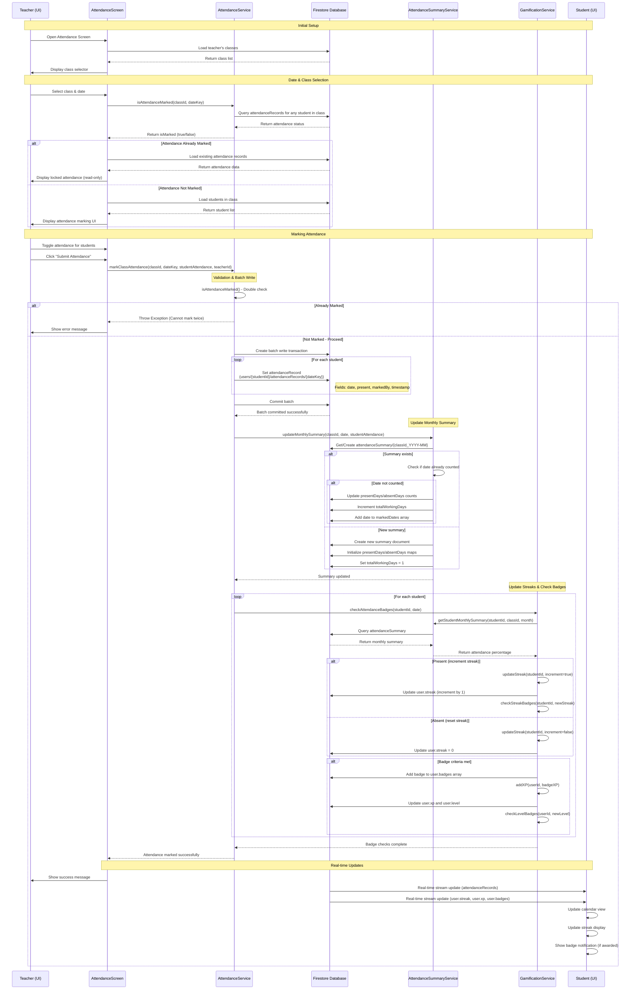

# Attendance Marking - Sequence Diagram

This document contains the sequence diagram for the attendance marking flow in the EduStreak application.

## Sequence Diagram

## Key Components

### 1. **Teacher Actions**
- Selects class and date
- Toggles attendance for each student (Present/Absent)
- Submits attendance

### 2. **Validation & Locking**
- System checks if attendance is already marked for the date/class
- Prevents duplicate marking (lock mechanism)
- Once submitted, attendance cannot be modified

### 3. **Data Storage**
- **Individual Records**: `users/{studentId}/attendanceRecords/{YYYY-MM-DD}`
- **Monthly Summary**: `attendanceSummary/{classId_YYYY-MM}`
- Uses Firestore batch writes for atomic operations

### 4. **Gamification Updates**
- **Streak Updates**:
  - Present → Increment streak by 1
  - Absent → Reset streak to 0
- **Badge Checks**:
  - Attendance badges (based on monthly percentage)
  - Streak badges (based on streak count)
  - Level badges (if level up occurs)
- **XP Awards**: Automatic XP for badges and level ups

### 5. **Real-time Updates**
- Students receive real-time updates via Firestore streams
- Calendar view updates automatically
- Streak and badge displays update in real-time

## Error Handling

- **Already Marked**: Throws exception if attendance is already marked
- **Network Errors**: Retry logic and error messages
- **Partial Failures**: Badge checks continue even if one student fails

## Performance Considerations

- **Batch Writes**: All attendance records written atomically
- **Parallel Processing**: Badge checks run in parallel for all students
- **Caching**: Monthly summaries cached to reduce queries
- **Streaming**: Real-time updates use Firestore streams for efficiency

